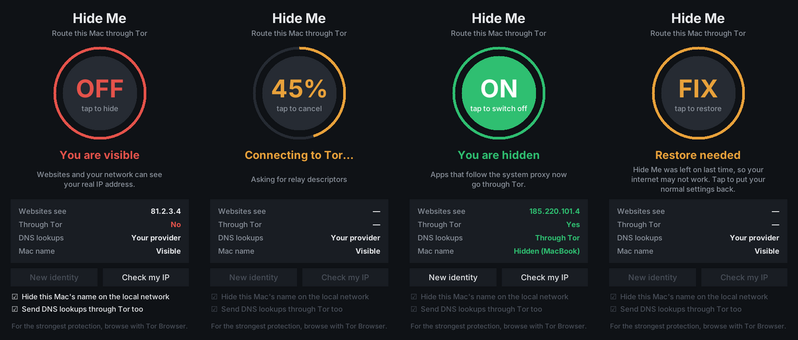

# Hide Me

One big switch that sends your Mac's internet traffic through [Tor](https://www.torproject.org/),
so websites see a Tor address instead of your real IP. Switch it off and everything goes back
exactly as it was.



## What happens when you switch it on

1. Tor starts on your Mac and connects to the Tor network. Your internet keeps working
   normally while it connects (usually 5–30 seconds).
2. Your current network settings are saved to disk.
3. After you enter your password, every active network connection (Wi-Fi, Ethernet, …) is
   pointed at Tor:
   - **IP address:** a system-wide SOCKS proxy, so apps that follow the system proxy go through Tor.
   - **DNS lookups** *(option, on by default)*: the sites you look up go through Tor too, so
     your internet provider can't see them.
   - **Mac name** *(option, on by default)*: your Mac's name on the local network (shown to
     others on the same Wi-Fi) becomes the generic "MacBook".

The window shows which IP address websites see now, and whether it is a Tor address.
**New identity** asks Tor for a new route, so new connections get a different IP.

Switching off puts every setting back from the saved copy and stops Tor. Quitting the app
does the same, after asking you first.

## What it can't hide

No tool can make you completely invisible. Be aware of these limits:

- **Accounts:** if you log in to Google, Instagram, your bank and so on, they know it's you,
  whatever your IP is.
- **Apps that ignore the system proxy:** many Terminal tools, games, and some apps connect
  directly, using your real IP.
- **Browsers:** WebRTC (video calls in the browser) can reveal your real IP, and your browser
  can be recognised by its "fingerprint". For the strongest protection, browse with
  [Tor Browser](https://www.torproject.org/download/), which works fine next to Hide Me.
- **Speed:** Tor is slower than your normal connection, and some sites show captchas or block
  Tor.
- **New connections:** only the network connections that exist when you switch on are covered.
  If you plug in a new adapter (for example, iPhone tethering over USB), switch off and on again.
- **Networks that block Tor:** some Wi-Fi networks, and some countries, block Tor. Hide Me then
  reports that Tor couldn't connect, and changes nothing.

## Install

You need macOS and [Homebrew](https://brew.sh).

```bash
git clone https://github.com/lillybaba1/hide-me.git
cd hide-me
./install.sh
```

This installs Tor and Python's window toolkit with Homebrew, adds **Hide Me** to
`~/Applications`, and adds a small login helper (see below). Keep the `hide-me` folder where
it is: the app runs the code from there.

You can also start it without installing: `python3 hideme.py` (needs `brew install tor python-tk`).

To remove it: `./install.sh --uninstall`.

## Why it asks for your password

Changing network settings for the whole Mac needs administrator rights, so macOS asks for your
password once when you switch on and once when you switch off. Hide Me never sees or stores
your password: the standard macOS prompt handles it.

## If your internet stops working

This can only happen if Hide Me was on when the app crashed or the Mac shut down, so your
settings still point at Tor, which isn't running any more.

- **Open Hide Me.** It notices and shows **FIX**. Tap it to restore your normal settings.
- The login helper does the same automatically the next time you log in.
- From Terminal: `python3 hideme.py --restore`
- By hand: **System Settings → Network → Wi-Fi → Details**. Under **Proxies**, turn off
  **SOCKS proxy**. Under **DNS**, remove `127.0.0.1`.

## How it works

| Part | File |
|------|------|
| The window and the switch | `hideme.py` |
| Tor, network settings and restoring them | `hideme_core.py` |
| Tests | `test_hideme_core.py` |

- Tor runs as your user, listens only on `127.0.0.1` (SOCKS 9060, control 9061, DNS 9053),
  and uses its own settings in `~/Library/Application Support/HideMe`. It exits by itself if
  the app dies, so it is never left running in the background.
- Proxy and DNS changes use `networksetup`. DNS is pointed at `127.0.0.1`, and a `pf` firewall
  rule (in its own anchor, `com.apple/hideme`) forwards port 53 to Tor's DNS port.
- The original settings are saved to `state.json` before anything changes. If that file exists
  but Tor isn't running, Hide Me knows it must restore.

## Tests

```bash
python3 -m unittest -v
```

The tests run on any Mac or Linux machine without admin rights. They run the real generated
admin scripts with stand-ins for `networksetup`, `pfctl` and `scutil`, start a stand-in Tor,
and, if Tor is installed, check that the real Tor accepts Hide Me's options.
